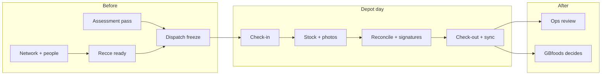

# GBfoods Stock Control — user guide

This is for people trying the pilot — field friends, BTL ops, and GBfoods reviewers. It explains who’s who, how a depot day actually flows, and how to click through the app without getting stuck.

Please don’t paste the passwords from this file onto a public landing page. Share the guide privately with people who are meant to test.

---

## What you’re looking at

We’re running a stock sorting programme across GBfoods distributor depots in Ghana. Crews go on site, separate saleable stock from suspect stock (especially Gino and Pomo Tomato Mix), take photos, and close the day with a signed reconciliation. This app is where that record lives.

In practice there are three sides:

- **Field** — phone. Check in, count stock, take photos, reconcile, check out. Works offline for a lot of the day; things only show up for GBfoods after they sync.
- **Ops** — laptop. Regions, people, recce, dispatch, reviewing what came back from the field.
- **GBfoods** — laptop. Control room. Read what’s synced, then decide what happens to held stock.

One rule that never bends: **QC sorts and classifies. The supervisor checks the record. Only GBfoods can release held stock.** Field and BTL cannot make held stock “saleable” on their own.

---

## Getting in

Ask whoever’s hosting for the live URL. On your own machine it’s usually:

| What | Address |
| --- | --- |
| Home | `http://localhost:3000` |
| Field sign-in | `http://localhost:3000/auth/field` |
| Ops / GBfoods sign-in | `http://localhost:3000/auth/ops` |

Use a phone for field. Use a laptop for ops and GBfoods.

Field people sign in with **staff ID + PIN**. Desk people (ops and GBfoods) use **email + password**. GBfoods uses the same ops sign-in page, then lands in the client control room.

---

## Who does what

| Role | Rough job | How they sign in |
| --- | --- | --- |
| **QC** | Owns the depot day — check-in, stock, photos, reconcile, signatures, exceptions | Field (PIN) |
| **Handler** | Helps count on a QC’s visit. Can’t close the depot or set quality decisions | Field (PIN) |
| **Cluster supervisor** | Looks after a handful of distributors. Checks evidence, signs as supervisor, helps with dispatch and escalations | Field on site; ops desk when planning |
| **Regional supervisor** | One per region. Coverage, readiness, daily return, chasing what’s still open | Field or ops |
| **National ops** | Sees everything. Network, people, dispatch freeze, day-to-day review | Ops (email) |
| **National quality** | Classification / quality issues, escalations — pushes toward a GBfoods decision when needed | Ops (email) |
| **Admin** | Users, PINs/passwords, master data, unlocks locked accounts | Ops (email) |
| **GBfoods reviewer** | Reads progress; records release / hold / reject / approve repack with a reason. Can’t rewrite field counts | Ops door → client home |
| **Depot rep** | Distributor person on site. **No login.** They sign on the QC’s phone | — |

There’s no separate “Project Director” app — they use the same national views.

---

## How a day actually moves

Think of it in three chunks.

### 1. Before anyone leaves for the depot

Ops sets up the map: region → distributor → depot. People get created and assigned. Someone runs **recce** on the depot (ready or hold — a critical gap forces hold, and you can’t dispatch a hold). Training **assessment** has to pass or that person stays off the roster.

Then someone builds **tomorrow’s route** under Dispatch: pick the cluster, add ready depots that have a usable QC, and hit **Freeze**. That locks the plan and creates the scheduled visits the field will work.

You’re ready when: depot is recce-ready, QC passed assessment and is assigned, route is frozen.

### 2. On the depot

QC (or handler) **checks in** with a photo. Location is nice if the phone can get it; if not, you still go ahead — we don’t geofence you.

They count stock into **zones**:

| Zone | Plain English |
| --- | --- |
| Unexamined | Not looked at yet |
| Conforming · pending release | Looks fine, waiting on GBfoods |
| Recoverable · pending approval | Intact but needs repack approval |
| Held or rejected | Suspect — needs a custodian and reason, then GBfoods |
| Released · remaining on site | Accepted and still sitting at the depot |

Held / recoverable lots need the photos the form asks for (pack, batch, defect). Something goes wrong on site? Raise an **exception** — that alerts ops; it doesn’t close the visit by itself.

At the end: **reconcile**. Numbers should balance. QC and the depot rep sign on the phone; the cluster supervisor can sign on site or from ops. Close clean, or close with an open action if something has to stay unresolved. Then **check out**.

If you were offline, stay signed in until sync finishes. GBfoods won’t see drafts that never left the phone.

### 3. After the field syncs

Ops skims attendance, stock, visits, escalations. Regional / national people file the **daily return**. GBfoods opens the control room, drills into a depot or lot, and records a **disposition** on anything that needs a decision.

Until GBfoods says so, held stock stays held.

### When things go sideways

| What happened | What you do | Who owns the call |
| --- | --- | --- |
| Quality / safety issue | Stop, secure the stock | Quality → GBfoods |
| Counts don’t match | Recount, isolate the disputed bit | Cluster supervisor |
| Can’t get in / crew problem | Switch depot or pull reserve | National ops |
| Way more volume / big delay | Reforecast before you expand | Ops + GBfoods |

Field raises it → ops triages (owner, due date, notes) → quality or GBfoods decide if it’s a disposition issue.

---

## Using the app in your role

### If you’re QC

Sign in on **Field** with your staff ID and PIN.

1. Open your depot (for the seed that’s usually Accra North).
2. Check in — photo required; location if you can.
3. Create stock lots: SKU, batch, quantity, unit, zone. Add photos when the form insists.
4. Report an exception if you need ops eyes on something.
5. Reconcile, get signatures, close the visit.
6. Check out.
7. If you worked offline, wait for sync (or tap **Sync now**).

You don’t release held stock. That’s GBfoods.

### If you’re a handler

Same field door. You help on a QC’s visit — counts and photos. You don’t close the depot as QC or set dispositions. For demos, just use the QC account; handlers are there for when the crew grows.

### If you’re a cluster supervisor

On site: same field app as QC — check what’s been captured, help reconcile, sign.

From the desk: make sure your depots are ready and your QCs can be dispatched, help freeze tomorrow’s route, review attendance/stock, sign visits, and tidy up escalations.

### If you’re a regional supervisor

Watch the region’s readiness and coverage. Help with dispatch. Submit the **daily return** for your region. Chase open escalations and unfinished depots before the national cutoff.

### If you’re national ops

Sign in on **Ops**. You’ll land on the dashboard.

Work left to right through the sidebar as needed: network → people / assignments → recce / assessment → dispatch → attendance / stock / escalations → daily return. You’re the person who keeps the whole day coherent.

### If you’re national quality

Same ops desk. Spend time on held lots and quality escalations. Push issues to GBfoods when a disposition is needed — you don’t release stock yourself.

### If you’re admin

Same ops desk, plus you’re the one creating users, resetting PINs/passwords, deactivating leavers, and unlocking someone who failed PIN too many times.

### If you’re GBfoods

Sign in on the ops/client page. You should land on the **control room**.

Glance at the numbers, filter by date/region/status, open a depot pack, open a lot that’s waiting, and record a disposition with a real reason. Export CSV if you want a spreadsheet. You can’t rewrite what the field typed — disposition is your write.

### If you’re the depot rep

You don’t get a login. When the QC opens reconcile, you sign on their phone.

---

## Accounts for the pilot seed

Same passwords every fresh seed. Change them before anything wider than a private pilot.

### Field

| Who | Role | Staff ID | PIN |
| --- | --- | --- | --- |
| Abena Mensah | QC | `BTL-0031` | `2468` |
| Kojo Asante | Cluster supervisor | `BTL-0105` | `1357` |

Abena is already on **Accra Fresh Distributors** (`GA-D01`), so she sees **Accra North Main Depot** (`GA-D01-01`).

New field people created under People get the next `BTL-####` automatically — you’ll see it in the success toast when you set their PIN.

### Desk

| Who | Role | Email | Password | Lands on |
| --- | --- | --- | --- | --- |
| Platform Admin | Admin | `admin@gbfoods.local` | `ChangeMe123!` | `/ops` |
| National Operations | National ops | `ops@gbfoods.local` | `ChangeMe123!` | `/ops` |
| GBfoods Reviewer | GBfoods | `reviewer@gbfoods.local` | `ChangeMe123!` | `/client` |

### Seed geography you can use straight away

Greater Accra (`GA`) → cluster `GA-C01` → Accra Fresh (`GA-D01`) → Accra North (`GA-D01-01`). There’s also Tema Port Side under Tema Logistics if you want a second depot. Priority SKUs: Gino and Pomo Tomato Mix (pack factor 24). Seed depots are marked ready.

### Quick “who should I be?”

| You’re… | Sign in as… | Try this |
| --- | --- | --- |
| On a phone | Abena `BTL-0031` | Check in, one good lot, one held lot, reconcile |
| Supervising | Kojo `BTL-0105` | Same field shell; help verify |
| Running the day | `ops@…` or `admin@…` | Dashboard, people, dispatch, review |
| Client | `reviewer@…` | Control room → held lot → disposition |

A solid demo arc: **ops prepares → QC works the depot → GBfoods decides.**

---

## Walkthrough if you want the click-by-click

### Field (Abena)

1. Field sign-in → `BTL-0031` / `2468`.
2. Open Accra North → check in with a photo. Skip location worry — no geofence.
3. Today’s stock lots → new lot → Gino or Pomo, batch, qty, unit, zone. Photos if held/recoverable.
4. Optional: Report an exception.
5. Reconcile → check the math → signatures → close (or open action).
6. Check out.

### Ops (admin or ops)

1. Ops sign-in → dashboard.
2. Sidebar: Regions / Distributors / Depots / Recce as needed.
3. People + Assignments + Assessment so someone can actually be dispatched.
4. Dispatch → pick date + cluster → add ready depots → Freeze.
5. Later: Attendance, Stock, Escalations, Daily return.

Admin and national ops both edit network data in this pilot. Admin is more “platform”; ops is more “run the day.”

### GBfoods (reviewer)

1. Same ops sign-in page → `reviewer@gbfoods.local` / `ChangeMe123!`.
2. Control room overview → filter → open a depot → open a pending lot.
3. Disposition + reason. Export if you want.

### A 30–45 minute demo that usually works

1. Ops: Accra North ready, Abena assigned and dispatchable; freeze a route if you want to show that.
2. QC: check in; one conforming lot and one held lot with photos; open reconcile.
3. Ops: attendance + stock for today; supervisor signature if you need it.
4. GBfoods: open the held lot; disposition with a reason.
5. Optional: QC raises an escalation; ops closes it under Escalations.

---

## What’s not in this pilot (on purpose)

No facial recognition, no live GPS trail, no “you’re too far from the depot” block. Depot reps don’t get accounts. Reconcile / close / disposition still need a connection. We’re not doing pricing, disposal, or lab workflows here.

---

## If you’re stuck

| What you see | Likely fix |
| --- | --- |
| Field home has no depots | Assign the user under Ops → Assignments |
| Can’t put a depot on dispatch | Recce isn’t ready, or the QC didn’t pass assessment / isn’t assigned |
| GBfoods can’t see a lot | Still sitting offline on the phone, or wrong date filter |
| Photo missing in ops | Upload storage glitch locally — you can still review the visit data |
| Sign-in fails | Wrong door (field vs ops), staff ID casing, or account deactivated |
| Locked after bad PINs | Five fails locks the account until admin/supervisor unlocks |

---

## Sharing this

Send the file (or a PDF) with the demo URL, and tell each person which account is theirs. Change the default password before this goes anywhere near a wider audience — these secrets are only for the pilot seed.
